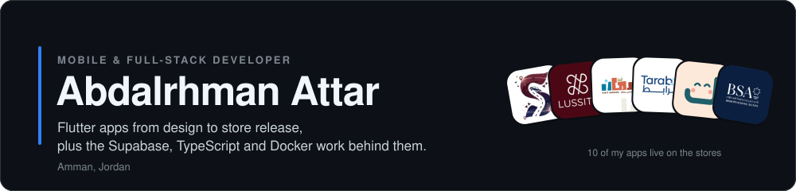
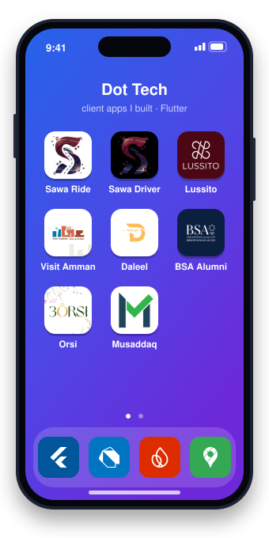
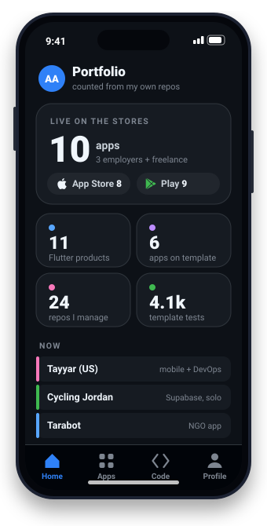
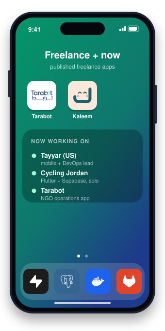
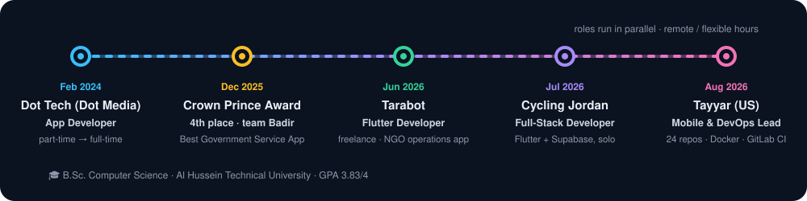

  

Tap a phone to jump to the app links or my roles.

I use **Claude Code** multi-agent workflows for builds, QA and audits, and I manage Apple Developer and Google Play organisation accounts end to end.

## 🧭 Where I've worked

<b>What I did in each role</b>

 

**Dot Tech (Dot Media)** — App Developer
- Built the in-house Flutter starter template that six client apps use: Bloc, go_router, Dio with retry and token refresh, four flavors with separate Firebase projects, Arabic/English RTL, 306 test files, GitHub Actions
- `make new-repo` / `make new-firebase` set up a new client project (repo, branch protection, CI secrets, Firebase) in about a day
- Built 11 Flutter products; supervised a junior developer and released her apps

**Tayyar Marketing and IT Consulting (US)** — Mobile & DevOps Lead
- Took over a six-product portfolio: 24 repos, one production server with ~30 Docker containers and ~30 Nginx sites
- Food-ordering platform: TypeScript backend (Bun, Fastify, PostgreSQL, Kafka), Next.js admin, three Expo apps
- Firewall, SSH clean-up, nightly PostgreSQL backups with tested restore, GitLab CI for 9 projects

**Cycling Jordan** — Full-Stack Developer
- Sole developer and designer of a bike-rental and cycling-tourism platform: Flutter app + Supabase (40 migrations, 48 RLS policies, ~75 database functions, edge functions, Realtime)

**Tarabot** — Flutter Developer (freelance)
- Multi-tenant NGO operations app on Google Play: aid delivery with OTP and signature proof, accounting, 200+ permission codes, 492 tests

## 📲 Published apps

<table>
<tr>
<td align="center" width="25%"> <b>Ride-sharing (rider)</b> Flutter · GetX · Pusher · Maps <a href="https://play.google.com/store/apps/details?id=com.dottech.sawaride">Play</a> · <a href="https://apps.apple.com/us/app/sawa-ride/id6757856032">App Store</a></td>
<td align="center" width="25%"> <b>Ride-sharing (driver)</b> Flutter · GetX · FCM · Maps <a href="https://play.google.com/store/apps/details?id=com.dottech.sawaridedriver">Play</a> · <a href="https://apps.apple.com/us/app/sawa-ride-driver/id6757861025">App Store</a></td>
<td align="center" width="25%"> <b>Fashion e-commerce</b> Flutter · Bloc · PayTabs · Geidea <a href="https://play.google.com/store/apps/details?id=com.dottech.lussito">Play</a> · <a href="https://apps.apple.com/us/app/lussito/id6795830923">App Store</a></td>
<td align="center" width="25%"> <b>Tourism app</b> Amman Chamber of Commerce <a href="https://play.google.com/store/apps/details?id=com.visit.amman.dottechjo">Play</a> · <a href="https://apps.apple.com/jo/app/visit-amman/id6748395517">App Store</a></td>
</tr>
<tr>
<td align="center"> <b>Car marketplace</b> Flutter · GetX · OTP <a href="https://play.google.com/store/apps/details?id=com.daleelalhurra.frontend">Play</a> · <a href="https://apps.apple.com/ly/app/%D8%AF%D9%84%D9%8A%D9%84-%D8%A7%D9%84%D8%AD%D8%B1%D8%A9/id6670617809">App Store</a></td>
<td align="center"> <b>Alumni community</b> WebSocket chat · QR tickets <a href="https://play.google.com/store/apps/details?id=com.dottech.bsa">Play</a> · <a href="https://apps.apple.com/us/app/bishop-school-alumni/id6766196524">App Store</a></td>
<td align="center"> <b>Lease contracts</b> e-signature · ID scan <a href="https://play.google.com/store/apps/details?id=com.dottech.musaddaq">Play</a> · <a href="https://apps.apple.com/us/app/musaddaq/id6760346078">App Store</a></td>
<td align="center"> <b>Wedding services</b> Flutter · GetX · deep links <a href="https://play.google.com/store/apps/details?id=com.dottech.orsi">Play</a></td>
</tr>
<tr>
<td align="center"> <b>NGO operations</b> Flutter · Bloc · 492 tests <a href="https://play.google.com/store/apps/details?id=com.tarabot.app">Play</a></td>
<td align="center"> <b>Speech-therapy parents</b> QR device pairing <a href="https://apps.apple.com/us/app/kaleem-parents/id6822817724">App Store</a></td>
<td align="center" colspan="2">Most of my code lives in private client repositories, so the public repos here are only a small part of my work.</td>
</tr>
</table>

## 🧰 Tech stack

## 🐍 Contributions

<picture>
  <source media="(prefers-color-scheme: dark)" srcset="https://raw.githubusercontent.com/Abdalrhman-Attar/Abdalrhman-Attar/output/snake-dark.svg"/>
  <source media="(prefers-color-scheme: light)" srcset="https://raw.githubusercontent.com/Abdalrhman-Attar/Abdalrhman-Attar/output/snake.svg"/>
  
</picture>
